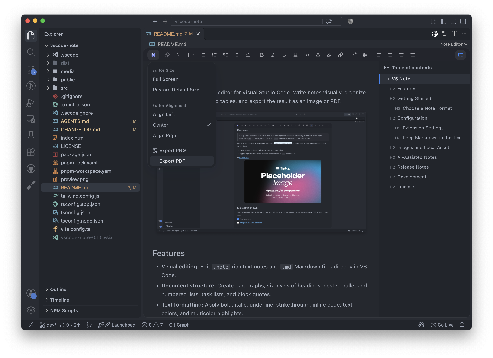

# VS Note

A rich text and Markdown editor for Visual Studio Code. Write notes visually, organize content with headings and tables, and export the result as an image or PDF.



## Features

- **Visual editing:** Edit `.note` rich text notes and `.md` Markdown files directly in VS Code.
- **Document structure:** Create paragraphs, six levels of headings, nested bullet and numbered lists, task lists, and block quotes.
- **Text formatting:** Apply bold, italic, underline, strikethrough, inline code, text colors, and multicolor highlights.
- **Links and alignment:** Insert links and align paragraphs or headings left, center, right, or justified.
- **Code blocks:** Write syntax-highlighted code with a language selector and a copy button.
- **Tables:** Insert tables with a size picker, add or remove rows and columns, toggle headers, merge or split cells, and resize columns.
- **Images:** Upload or paste images, store them as local assets, resize them while preserving their aspect ratio, and align them left, center, or right.
- **Heading navigation:** Use a generated table-of-contents sidebar to jump between sections and follow the active heading as you scroll.
- **Flexible layout:** Customize the editor width and placement, or expand it to fill the available editor area.
- **Theme integration:** Work with VS Code light and dark themes.
- **Export:** Save the rendered note as a PNG image or an A4 PDF from the note menu.

## Installation

- **Extension name:** VS Note
- **Extension ID:** `lanyue.vsnote-editor`
- **Marketplace:** [VS Note on Visual Studio Marketplace](https://marketplace.visualstudio.com/items?itemName=lanyue.vsnote-editor)

In the VS Code Extensions view, search for `@id:lanyue.vsnote-editor` and select **Install**, or run:

```sh
code --install-extension lanyue.vsnote-editor
```

## Getting Started

1. Install VS Note in Visual Studio Code.
2. Create or open a `.note` or `.md` file. VS Note registers **Note Editor** as the default editor for both extensions unless you have configured another editor association.
3. Write and format your content using the toolbar.
4. Save with VS Code's usual Save command.
5. Open the note menu to adjust the editor layout or export to PNG or PDF.

Prefer editing Markdown source? Follow **Keep Markdown in the Text Editor** below to use VS Note for `.note` files while opening `.md` files in the standard text editor.

### Choose a Note Format

| Format  | Best for                                                                     | Saved as         |
| ------- | ---------------------------------------------------------------------------- | ---------------- |
| `.md`   | Portable notes using supported Markdown structures                           | Markdown text    |
| `.note` | Rich text notes that need colors, highlights, image dimensions, or alignment | An HTML fragment |

> **Note:** Markdown editing does not currently support saving all styles available in the visual editor. Some formatting may be lost when saving as `.md`. Use `.note` files to retain supported rich text styles.

Visual editing parses and serializes the document, so source formatting may be normalized. Use `.note` when rich formatting must be retained; Markdown does not reliably preserve every visual style. Unsupported Markdown extensions or custom HTML are not guaranteed to survive editing.

## Configuration

Open VS Code Settings and search for `vsnote`, or use **Preferences: Open User Settings (JSON)** from the Command Palette. Use workspace settings if the configuration should apply only to the current project.

### Extension Settings

| Setting                    | Default     | Description                                                                                                                                                                                   |
| -------------------------- | ----------- | --------------------------------------------------------------------------------------------------------------------------------------------------------------------------------------------- |
| `vsnote.imageUploadFolder` | `"/assets"` | Folder for uploaded and pasted images. A leading `/` resolves from the workspace root; a relative path resolves from the note's directory. Uploads are intended to stay within the workspace. |
| `vsnote.editorMaxWidth`    | `""`        | Maximum editor width. An empty string uses the default 896px width. Accepts a positive pixel width such as `"1200"` or `"1200px"`, or `"fullscreen"` to fill the available editor width.      |
| `vsnote.editorAlignment`   | `"center"`  | Horizontal placement of the editor: `"left"`, `"center"`, or `"right"`. This controls the editor's position, independently of text and image alignment within a note.                         |

Example `settings.json` configuration:

```json
{
  "vsnote.imageUploadFolder": "/assets",
  "vsnote.editorMaxWidth": "1200px",
  "vsnote.editorAlignment": "center"
}
```

Merge these entries into your existing settings rather than replacing the entire file. The note menu also provides controls for full-width editing, restoring the default size, and editor placement.

### Keep Markdown in the Text Editor

By default, VS Note offers its visual editor for both `*.note` and `*.md` files. If you prefer Markdown source editing, configure VS Code's built-in `workbench.editorAssociations` setting:

```json
{
  "workbench.editorAssociations": {
    "*.md": "default",
    "*.note": "note.editor"
  }
}
```

- `"*.md": "default"` opens Markdown files in VS Code's standard text editor instead of VS Note.
- `"*.note": "note.editor"` explicitly keeps rich text notes associated with VS Note.
- Add these mappings to any existing `workbench.editorAssociations` object; keep your other file associations.
- Put this in User Settings to use it across projects, or in `.vscode/settings.json` for the current workspace. Check workspace settings if they override your user preference.
- Close and reopen an already open Markdown tab, or use **View: Reopen Editor With...** and select **Text Editor**.

This changes the default editor for Markdown files. VS Note remains available through **Reopen Editor With...**, and VS Code's built-in Markdown preview remains available when you explicitly open it.

You can also change the association through the editor picker:

1. Open a Markdown file.
2. Run **View: Reopen Editor With...** from the Command Palette.
3. Choose **Configure Default Editor for '\*.md'...**.
4. Select **Text Editor**.

To use VS Note as the Markdown default again, change the `*.md` mapping to `"note.editor"`, or select **Note Editor** in the default-editor picker.

## Images and Local Assets

Upload an image from the toolbar or paste one from the clipboard. VS Note saves it in the configured upload folder and inserts a path relative to the note's directory.

- The upload control accepts up to three image files per selection.
- Each uploaded image may be at most 5 MiB.
- Saved image filenames use a random UUID, retaining the original file extension without the original name.
- The default `/assets` upload folder is relative to the workspace root. For example, an image used by `notes/meeting.note` may be saved with a `../assets/` source path.
- Set `vsnote.imageUploadFolder` to a relative value such as `"images"` to save assets in an `images` folder beside each note.
- When opening a saved note outside a workspace, its directory is used as the upload root. Save an untitled note before uploading images. Upload paths outside the workspace or standalone note directory are rejected.
- Keep referenced images with your notes when moving or sharing them.

## AI-Assisted Notes

For Codex-assisted writing, place an `AGENTS.md` in the **workspace containing your notes**. The [repository's AGENTS.md](AGENTS.md) is a ready-to-copy guide to supported nodes, formatting, file formats, and compatibility rules.

When your notes live in another project, copy the guide into that project's `AGENTS.md`, or merge its note-writing rules into an existing file. Installing the extension alone does not give AI agents those instructions.

## Release Notes

See [CHANGELOG.md](CHANGELOG.md) for the initial release's feature list and subsequent release notes.

## Development

1. Install dependencies: `pnpm install`
2. Open the repository in VS Code and press `F5` to launch the Extension Development Host.
3. Build the extension with `pnpm package`, or run `pnpm lint` to check the source.

## License

[MIT](LICENSE) · lanyue
